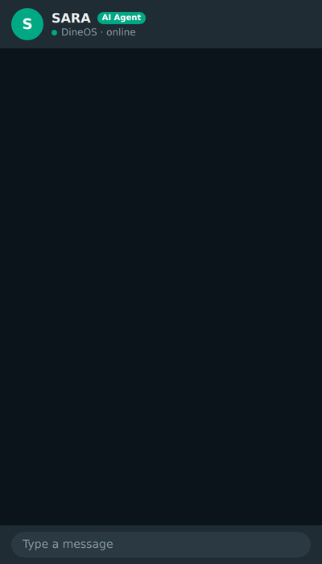
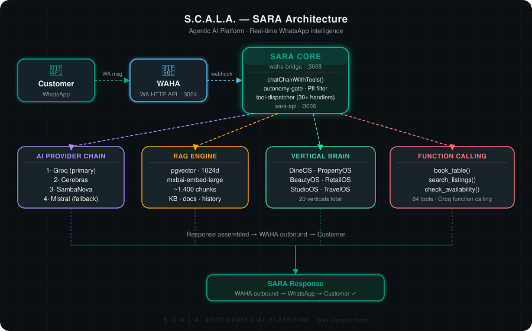

<div align="center">
<h1>SARA</h1>
<p><strong>Open-source WhatsApp AI agent — 20 verticals defined, 13 brains included</strong></p>

[](https://www.gnu.org/licenses/agpl-3.0)
[](https://hub.docker.com)
[](https://www.typescriptlang.org)
[](CONTRIBUTING.md)
[](https://github.com/Alessandro114/sara)

**SARA is a self-hostable AI agent for WhatsApp that understands your industry. 13 industry brains included in this repo; 20 verticals are defined in the open [`@scala-ai/agent-definitions`](https://github.com/Alessandro114/scala-agent-definitions) schema (Apache-2.0), and you can write your own. 87 tool definitions. Function calling. RAG. Multi-language.**

[Documentation](#configuration) · [Cloud Version](https://get-scala.com) · [Contributing](CONTRIBUTING.md)



</div>

---

## Why SARA?

- **vs Generic chatbots (Tidio, Landbot):** SARA knows your industry. A restaurant bot books tables and checks allergens. A clinic bot schedules patient appointments. Generic bots just answer FAQs.
- **vs Enterprise platforms (Salesforce, ServiceNow):** Self-host for free. No vendor lock-in. No six-figure contracts. Full source access.
- **vs Building from scratch:** the verticals are already wired — knowledge bases, tools, prompts, fallbacks. 13 brains ship in this repo, 20 are defined in the open schema. You add your data, not your architecture.
- **vs Other open source (Chatwoot, Typebot):** SARA is an AI agent with function calling, RAG retrieval, PII anonymization, and autonomy levels — not just a chat widget with canned replies.

---

## Features

### AI Engine

- Multi-provider LLM chain (Groq → Cerebras → SambaNova → Mistral) with automatic failover — zero downtime when one provider is rate-limited
- RAG retrieval: PostgreSQL + pgvector (1024d embeddings) + BM25 keyword fallback for hybrid search
- Function calling with 87 tool definitions across 20 industry verticals — agents can actually *do* things, not just respond
- PII anonymization before every external LLM call — names, phones, emails are masked at the boundary
- Prompt injection guardrails: 40+ patterns, 4 languages, evaluated before every turn
- Hallucination detection + confidence scoring on AI responses

### WhatsApp

- Voice messages: speech-to-text via Whisper
- Image understanding via vision AI
- PDF and document processing
- Location, contacts, and sticker support
- Rate limiting + anti-ban protection built in

### Industry Verticals (20)

| Vertical | Key tools |
|---|---|
| DineOS (restaurants) | Table booking, menu, allergens, price list |
| PropertyOS (real estate) | Listings, valuations, inspections |
| BeautyOS (salons) | Appointments, treatments, membership |
| MotorOS (automotive) | Test drives, service booking, trade-in |
| WellnessOS (gyms) | Class booking, membership management |
| PraxisOS (clinics) | Patient scheduling, intake forms |
| ShopOS (retail) | Product search, stock check, reservations |
| AgencyOS | Client intake, brief collection |
| StudioOS | Creative project booking, SAL generation |
| CleanOS | Cleaning service scheduling |
| TravelOS | Itinerary search, booking requests |
| NetworkOS | Event registration, networking |
| DermalyOS | Dermatology intake, appointment |
| FranchiseOS | Franchise lead qualification |
| ProjectOS | Project status, task updates |
| ReputationOS | Review collection, feedback routing |
| LandIQ | Real estate feasibility queries |
| AdOS | Campaign briefing, performance queries |
| ServiceOS | Field service scheduling |
| TenderOS (public tenders) | Tender parsing, deadlines, gap analysis, checklists |

### Platform

- Multi-language: Italian, English, Spanish, Portuguese
- Conversation memory: history (L4) + contact profiles (L5) + RAG knowledge base (L6)
- Human takeover: AI / human / hybrid mode per conversation, switchable in real time
- Built-in dashboard: analytics, session overview, conversation logs
- Autonomy levels: OFF / OBSERVE / SEMI-AUTO / FULL-AUTO configurable per tenant

---

## Quickstart

```bash
git clone https://github.com/Alessandro114/sara.git
cd sara
cp .env.example .env
# Edit .env — minimum required: GROQ_API_KEY (free at console.groq.com)
docker compose up -d
```

- Verify: `curl http://localhost:3006/api/sara/health`
- Connect WhatsApp: open `http://localhost:3006/api/sara/qr` and scan the QR code with your WhatsApp number.

SARA is running. Send a message to the connected number.

---

## Architecture



```
Customer (WhatsApp)
    |
    v
WAHA (WhatsApp Web API)
    |
    v
SARA Core (Node.js + Fastify)
    |-- AI Provider Chain (Groq -> Cerebras -> SambaNova -> Mistral)
    |-- RAG Engine (PostgreSQL + pgvector, 1024d)
    |-- Vertical Brain (DineOS / PropertyOS / BeautyOS / ...)
    |-- Function Calling (book_table / search_listings / schedule_appointment / ...)
    |-- PII Anonymizer
    |-- Prompt Injection Guard
    |-- Memory (L4 history + L5 profiles + L6 RAG)
    |
    v
Response -> Customer
```

### Message flow

1. **WAHA** receives the WhatsApp message and POSTs it to `/api/waha-webhook` (`src/sara-api.ts`; `waha-bridge.cjs` is the bridge process).
2. **Handlers** (`src/handlers/`) pick the type: text, voice (transcribed), image, document.
3. **Guards** run first: prompt-injection guard, PII anonymizer, and the human-takeover check (`src/lib/human-takeover.ts`): if an operator took the chat (`human`) SARA only listens; in `hybrid` it drafts and waits.
4. **Context**: sector detection (`src/sectors.ts`), the vertical prompt (`src/vertical-prompts.ts`, `src/prompts/vertical.<lang>.json`), memory (L4 history, L5 profile, L6 RAG).
5. **LLM chain** (`src/lib/ai-providers.ts`): Groq, then Cerebras, SambaNova, Mistral on failure or rate limit.
6. **Tool dispatcher** (`src/lib/tool-dispatcher.ts`): when the model calls a tool (book_table, check_availability, ...), the handler runs against the database and the result is fed back to the model for the final text.
7. **Output guards** (`src/lib/output-guard.ts`, `output-enforcer.ts`) check the reply, then it is sent through WAHA.

### RAG pipeline

Documents are chunked and embedded with a 1024-dimension model into PostgreSQL + pgvector. At question time the query is embedded with the same model, the nearest chunks are retrieved (hybrid with BM25, `src/lib/bm25-search.ts`) and injected into the prompt as the L6 memory layer. Ingest and query must use the same model (see Configuration).

### Autonomy gate and risk classifier

Each tool has a risk level (`getToolRisk`: `low` info-only, `medium` creates or changes a record, unknown tools default to `medium`). The tenant's autonomy level (`sara_autonomy_settings`) decides what runs on its own (`shouldQueueAgenticAction`, `src/lib/autonomy-gate.ts`):

| Level | low | medium | high / critical |
|---|---|---|---|
| OFF | runs | runs | runs |
| OBSERVE | queued | queued | queued |
| SEMI_AUTO | runs | queued | queued |
| FULL_AUTO | runs | runs | queued |

Queued actions wait for human approval instead of being executed.

---

## Configuration

Key environment variables (see `.env.example` for the full list):

| Variable | Required | Description |
|---|---|---|
| `GROQ_API_KEY` | Yes | Primary LLM provider. Free at [console.groq.com](https://console.groq.com) |
| `CEREBRAS_API_KEY` | No | Fallback LLM provider |
| `SAMBANOVA_API_KEY` | No | Fallback LLM provider |
| `MISTRAL_API_KEY` | No | Fallback LLM provider |
| `DATABASE_URL` | Yes | PostgreSQL connection string (pgvector required) |
| `WAHA_URL` | Yes | WAHA instance URL (default: `http://localhost:3004`) |
| `WAHA_API_KEY` | Yes | WAHA authentication key |
| `SARA_VERTICALS` | No | Comma list of tool keys to keep active (e.g. `dine` for a restaurant). Empty = all verticals; other sectors get the general tools only |
| `EMBED_MODEL` | No | Embedding model — must be 1024d. Default: `mxbai-embed-large` |
| `OLLAMA_BASE_URL` | No | Ollama URL if using local embeddings |
| `SARA_AUTONOMY_LEVEL` | No | `OFF` / `OBSERVE` / `SEMI_AUTO` / `FULL_AUTO`. Default: `OBSERVE` |

### Telegram channel

Set `TELEGRAM_BOT_TOKEN` (from @BotFather) and SARA also answers private Telegram chats with the same handlers (text, voice notes, photos, documents, location). Chats are stored as `tg:<chat_id>`. `TELEGRAM_ALLOWED_CHATS` (comma list of chat ids) restricts who can talk to the bot. It uses long polling, so no public URL is needed. Group chats are ignored.

### Voice replies (TTS)

`SARA_TTS_REPLY=voice_only` answers voice notes with a voice note, `always` voices every short reply (up to `SARA_TTS_MAX_CHARS`, default 600), `off` (default) disables it. Uses [edge-tts](https://github.com/rany2/edge-tts) (`pip install edge-tts`, no API key); override voices with `SARA_TTS_VOICE_IT` etc. If synthesis fails SARA sends the text reply. Voice notes are sent on WhatsApp through WAHA `sendVoice` and on Telegram through `sendVoice`.

### Dashboard

`/api/sara/dashboard` (API key required) lists leads, the full message history (AI and customer), the tools SARA executed in each conversation, and lets you switch a conversation between AI, human and hybrid mode. The open conversation refreshes every 15 seconds.

### Webhooks (n8n / Make.com / Zapier)

Set a URL per event to have SARA POST a JSON event; an empty URL disables that event.

| Event | Env var | `data` |
|---|---|---|
| `conversation.started` | `SARA_WEBHOOK_CONVERSATION_STARTED` | `phone`, `sector` |
| `booking.confirmed` | `SARA_WEBHOOK_BOOKING_CONFIRMED` | `phone`, `tool`, `result` |
| `takeover.requested` | `SARA_WEBHOOK_TAKEOVER_REQUESTED` | `phone`, `mode`, `taken_by`, `reason` |
| `lead.qualified` | `SARA_WEBHOOK_LEAD_QUALIFIED` | `phone`, `result` |

Body: `{"event": "...", "timestamp": "<ISO 8601>", "data": {...}}`, header `X-Sara-Event`. If `SARA_WEBHOOK_SECRET` is set the body is signed: `X-Sara-Signature: sha256=<HMAC-SHA256 hex>`. Failed calls (network, 5xx, 429) are retried with exponential backoff (`SARA_WEBHOOK_RETRIES`, default 3; `SARA_WEBHOOK_TIMEOUT_MS`, default 5000); other 4xx are not retried. Delivery never blocks the chat reply.

> The embedding model **must produce 1024-dimensional vectors**. Changing to a different dimension silently breaks RAG retrieval. Supported: `mxbai-embed-large`, `jina-embeddings-v3`. Do not use `nomic-embed-text` (768d).

---

## Self-hosted vs Cloud

| Feature | Self-hosted (free) | Cloud ([get-scala.com](https://get-scala.com)) |
|---|---|---|
| AI chat engine | Yes | Yes |
| 20 verticals defined / 13 brains included | Yes | Yes |
| Function calling (30+ tools) | Yes | Yes |
| RAG engine | Yes | Yes |
| Multi-language | Yes | Yes |
| Dashboard | Yes | Yes |
| Multi-number (multi-tenant) | No | Yes |
| White-label | No | Yes |
| Advanced analytics | No | Yes |
| Priority support | No | Yes |
| Managed infrastructure | No | Yes |

---

## Contributing

Contributions are welcome. See [CONTRIBUTING.md](CONTRIBUTING.md) for guidelines.

Good first issues are labeled [`good first issue`](https://github.com/Alessandro114/sara/labels/good%20first%20issue). If you want to add a new vertical, open an issue first so we can align on the tool schema before you build.

---

## License

SARA is licensed under [AGPL-3.0](LICENSE).

You can self-host and modify it freely. If you distribute a modified version, you must release the source code under the same license. For commercial licensing (use without AGPL obligations), contact [ale@get-scala.com](mailto:ale@get-scala.com).

---

## Built by

SARA is the AI engine behind [S.C.A.L.A. AI OS](https://get-scala.com) — an enterprise AI operating system for businesses.

Built by [Alessandro Binda](https://www.linkedin.com/in/alessandrobinda/), a GM turned AI builder with 18 years of industry experience and P&L ownership up to EUR 33M.

- Website: [get-scala.com](https://get-scala.com)
- LinkedIn: [linkedin.com/in/alessandrobinda](https://www.linkedin.com/in/alessandrobinda/)
- Twitter/X: [@alessandrobinda](https://x.com/alessandrobinda)

---

<div align="center">

**If SARA saves you time, [give it a star](https://github.com/Alessandro114/sara)**. It helps other developers discover it.

</div>

---

## Ecosystem

Part of the **S.C.A.L.A.** open-source ecosystem:

| Project | What it does |
|---------|-------------|
| [SARA](https://github.com/Alessandro114/sara) | WhatsApp AI agent — 20 verticals defined, 13 brains included |
| [LandIQ](https://github.com/Alessandro114/landiq) | Autonomous real estate feasibility agent |
| [scala-sites](https://github.com/Alessandro114/scala-sites) | 100 vertical website templates (Next.js, MIT) |
| [scala-agent-definitions](https://github.com/Alessandro114/scala-agent-definitions) | 87 AI tool definitions for 20 verticals |
| [scala-mcp-server](https://github.com/Alessandro114/scala-mcp-server) | MCP server for Claude/ChatGPT — 250M+ companies |
| [Score SDKs](https://github.com/Alessandro114/scala-score-js) | Company data — [JS](https://npmjs.com/package/scala-score) · [Python](https://pypi.org/project/scala-score) · [Go](https://github.com/Alessandro114/company-lookup-go) · [Rust](https://github.com/Alessandro114/score-rust) · [Deno](https://github.com/Alessandro114/scala-score-deno) |
| [enrich-companies](https://github.com/Alessandro114/enrich-companies) | CSV enrichment CLI — [npm](https://npmjs.com/package/enrich-companies) · [pip](https://pypi.org/project/enrich-companies) |
| [n8n node](https://github.com/Alessandro114/n8n-nodes-scala) | n8n community node for company data |
| [awesome-whatsapp-ai](https://github.com/Alessandro114/awesome-whatsapp-ai) | Curated list of WhatsApp AI tools & frameworks |

